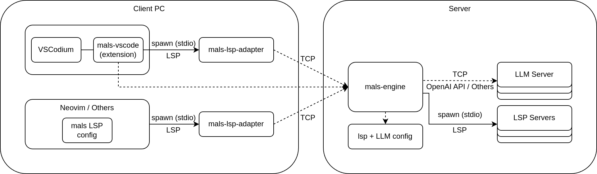

# docs

## Architecture

В данном разделе описана архитектура системы в целом и для компонентов по отдельности, а также представленны диаграммы.

### System

Разработанная система состоит из следующих компонентов:

- `mals-vscode` - расширение для `VSCode`, `VSCodium` и прочих сборок (далее `VSCode`), настраивающее и запускающее адаптер `LSP` `mals-lsp-adapter` и реализующее специфичные для `VSCode` функции.

- `mals-lsp-adapter` - клиент, обеспечивающий базовую функциональность системы, коммуницирующий с тектовыми редакторами по `stdio` согласно спецификации `LSP`. Запускается непосредственно текстовым редактором.

- `mals-engine` - сервис, реализующий основную логику системы. Общается с `LSP` серверами, таким образом получая семантическую информацию о проекте, и с `LLM` серверами, дополнительно расширяющими ответы.
    - Запускает `LSP` сервера по необходимости клиентов.
    - Подключается к `LLM` серверам, общаясь согласно стандартам (например, `OpenAI API spec`).

Таким образом, через `mals-lsp-adapter` реализуется функциональность, которая будет сразу поддерживаться текстовыми редакторами, которые поддерживают `LSP`, а для расширения этой функциональность для конкретных текстовых редакторов реализуются плагины или расширения (например, как для `VSCode` расширение `mals-vscode`).

## Development

В данном разделе описывается текущее состояние разработки и основные функциональности реализованных компонентов.

### `mals-vscode`

- Конфигурация `mals-lsp-adapter` и его запуск через `settings.json` и настройки `VSCode`.

> Платформоспецифичные функции не реализованы.

### `mals-lsp-adapter`

- Общение с клиентами (текстовыми редакторами) через `stdio`
- Общение с `mals-engine` через `TCP, bidirectional`.

Прочее:

- Логирование (файл)
- Параметризация запуска, смотреть описание через передачу параметра `-h`.

> Текущая функциональность адаптера - `proxy` без модификации запросов/ответов.

### `mals-engine`

- Независимая обработка запросов от нескольких клиентов
- Поддержка нескольких `workspace` для каждого клиента
- Настройка конфигурации (`LLM` серверов, `LSP` серверов и `workspace` клиентов) через конфигурационный файл
- Генерация автодополнения с использованием выбранной `LLM` (смотреть `internal/workspace/completion.go` и `internal/workspace/completion_prompt.go`)

LSP:

- Полная синхронизация файлов от клиентов `TextDocumentSync FULL`.
- Автодополнение `CompletionProvider`

Прочее:

- Логирование (stdout)
- Параметризация запуска, смотреть описание через передачу параметра `-h`.

## Tests

### VSCode Extension

